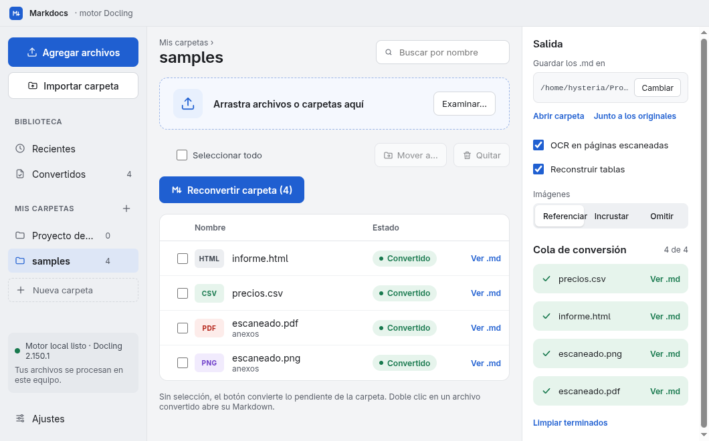

# Markdocs

Aplicación de escritorio para **Windows** que convierte tus documentos a **Markdown** sin que salgan de tu equipo. Usa [Docling](https://docling.ai/) como motor de conversión.



## Qué hace

- **Convierte** PDF, DOCX, XLSX, PPTX, ODT/ODS/ODP, HTML, CSV, AsciiDoc, EPUB e imágenes (PNG, JPG, TIFF, BMP, WEBP) a Markdown.
- **Carpetas**: crea carpetas de proyecto para agrupar archivos, o importa una carpeta de Windows completa (con subcarpetas; la salida replica la estructura).
- **Un archivo o muchos**: selecciona archivos sueltos, o deja la selección vacía para convertir todo lo pendiente de la carpeta.
- **Arrastrar y soltar** archivos y carpetas en cualquier parte de la ventana.
- **OCR** para páginas escaneadas y **reconstrucción de tablas**.
- **Imágenes** referenciadas como archivos, incrustadas en base64 u omitidas.
- **Vista previa** del original junto al Markdown (renderizado o código), copiar al portapapeles y abrir en el Explorador.
- **Cola de conversión** con cancelación y reintento; tema claro y oscuro.
- **Local**: después de la instalación inicial del motor, no necesita internet.

## Instalación

1. Descarga `Markdocs-Setup-x.y.z.exe` desde [Releases](https://github.com/omarmendozaaa/markdocs/releases).
2. Ejecútalo. El instalador no está firmado, así que Windows SmartScreen puede mostrar un aviso: «Más información» → «Ejecutar de todas formas».
3. En el primer inicio, Markdocs ofrece **instalar el motor Docling**. Descarga Python, Docling y los modelos (≈ 2 GB) en la carpeta de datos de la app; tarda varios minutos y solo se hace una vez.

Requisitos: Windows 10/11 de 64 bits y unos 3 GB de espacio libre.

## Cómo funciona

```
Electron (main) ──── IPC ──── React (renderer)
      │
      ├── library.json        carpetas, archivos y ajustes
      └── engine/worker.py    proceso Python persistente con Docling
              ▲  JSON por línea (stdin/stdout)
```

- El motor vive en `%APPDATA%\Markdocs\engine`: un entorno virtual creado con [uv](https://docs.astral.sh/uv/) (incluido en el instalador), con su propio Python y los modelos. No modifica el Python del sistema. Para desinstalarlo basta borrar esa carpeta.
- El worker mantiene los modelos cargados entre conversiones, por lo que solo el primer archivo paga el coste de carga.
- Las carpetas de Markdocs son listas de archivos: quitar un archivo o una carpeta en la app **nunca borra nada del disco**.
- Por defecto los `.md` se guardan en `Documentos\Markdocs\<carpeta>`; se puede cambiar por carpeta o guardar junto a cada original.

## Desarrollo

Necesitas Node.js 22+ y [uv](https://docs.astral.sh/uv/) en el `PATH` (en desarrollo se usa el `uv` del sistema). Funciona también en Linux.

```bash
npm install
npm run dev          # app con recarga en caliente
npm run typecheck
npm run build        # compila a out/
```

Prueba de extremo a extremo (instala el motor real y convierte los documentos que pongas en `.e2e/samples/`):

```bash
npm run build && npm run e2e
```

Generar el instalador de Windows (en Windows):

```bash
node scripts/fetch-uv.mjs win   # descarga uv.exe a resources/bin
npm run dist:win                # dist/Markdocs-Setup-x.y.z.exe
```

Cada push a `main` compila el instalador en GitHub Actions (artefacto `Markdocs-Windows`); una etiqueta `v*` publica además un Release.

### Estructura

| Ruta | Contenido |
| --- | --- |
| `src/main` | Proceso principal: biblioteca, cola, instalación del motor, IPC |
| `src/preload` | Puente seguro (`window.api`) |
| `src/renderer` | Interfaz React |
| `src/shared` | Tipos compartidos |
| `engine/worker.py` | Worker de Docling |

## Limitaciones conocidas

- El progreso es por etapas (cargar modelos, analizar, escribir); Docling no informa del avance página a página.
- Los PDF protegidos con contraseña no se pueden convertir.
- El motor se instala con PyTorch para CPU.

## Licencia

[MIT](LICENSE). Markdocs es un proyecto independiente, no afiliado al proyecto Docling. Docling se distribuye bajo licencia MIT; los modelos que descarga tienen sus propias licencias.
